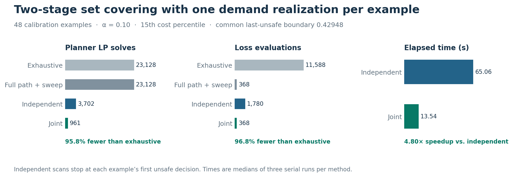

# Batch Conformal Decision Theory with Fewer Counterfactual Evaluations

Code and reproducible experiments for
[the paper](paper/main.pdf) ([LaTeX source](paper/main.tex);
[alphaXiv preprint](https://www.alphaxiv.org/abs/2611.batch-conformal-counterfactual-evaluations)).

We study the number of counterfactual planner calls needed for exact batch
calibration. The paper gives an order-statistic reduction for monotone binary
losses, black-box query bounds, and a backward search along a planner's
solution path. For parametric linear programs the path is generated only
as needed, reducing optimization solves as well as loss evaluations.

[Presentation slides](presentation/slides.pdf) · [Editable slide source](presentation/slides.tex)

## What the joint sweep saves

For **two-stage set covering with one demand realization per calibration example** at the published threshold (15th cost percentile), all methods recover the same last-unsafe boundary (0.42948). Relative to full enumeration, the on-demand joint sweep uses **95.8% fewer planner solves** (961 versus 23,128) and **96.8% fewer loss evaluations** (368 versus 11,588). Relative to the stronger baseline that already stops each example independently, it reduces **median serial runtime from 65.06 s to 13.54 s**, a **4.80× speedup** in three runs per method.

Across the 34 set-covering task–threshold combinations, the joint sweep uses a median of **29.1% fewer planner solves and 30.3% fewer loss evaluations** than independent stopping.

The original full-enumeration records give **estimated speedups of 44.5× and 74.6×** for one and ten demand realizations per example. These divide the sum of the measured exhaustive stages (388.96 s and 1,358.31 s) by the median end-to-end sweep time from the same experiment (8.749 s and 18.206 s). Generating all paths first and then sweeping their losses gives estimated ratios of 32.5× and 16.6×. The 4.80× and 4.41× comparisons use separate, fully timed runs of independent and joint stopping.



The same controlled timing comparison gives **1.96×** on knapsack (three runs per method) and **4.41×** on set covering with ten demand realizations per example (three runs per method). Across three tasks and 17 thresholds per task, the joint sweep returns the exhaustive cutoff in **51/51** settings. Both planner solves and loss evaluations fall by at least 25% against independent stopping in **40/51** settings.

| Additional experiment | Observed result |
| --- | --- |
| Graded set-cover recourse loss | At the original binary operating thresholds, joint stopping saves 79.0% (one demand realization) and 83.6% (ten demand realizations) of evaluations against independent saturation stopping. Across all 17 thresholds the median is about 40% for each task, reaching 0% at the highest threshold. |
| Black-box selection | Across 54 combinations of size, grid and threshold distribution, two-way anchored selection uses a median 21.9% fewer queries than three-way anchored selection. Certified bisection wins in the dense uniform example. |
| Integer decision planners | On 100 synthetic 22-variable binary planners, exhaustive enumeration independently recovers all 1,311 winning pieces. The lazy graded sweep uses 18.6% fewer solver calls and 31.8% fewer loss evaluations than full-path calibration. |

[All experiments, figures and reproduction commands](experiments/README.md) · [Results notebook](experiments/extension_experiments.ipynb) · [Raw timing observations](experiments/joint_stopping/timings.jsonl)

## Reproduce the public-data experiments

```bash
python -m pip install -r requirements.txt
python benchmark_public_cdt.py --repeats 11 --audit
python benchmark_public_cdt.py --threshold-sweep
```

The script uses original coefficients from two families in Beasley's
[OR-Library](https://people.brunel.ac.uk/~mastjjb/jeb/orlib/):

- `mknap2`: 48 multidimensional knapsack instances;
- `scp41`--`scp410`: ten set-covering instances, used to generate 48
  fixed-seed subsets of required rows.

The planners are **LP relaxations**, not the original integer programs.
Their binary losses are constructed for this experiment and do not constitute
observed safety outcomes. Every method uses the same matrices and SciPy
HiGHS solver. The optional `--audit` independently solves all 12,384 grid
problems and verifies the common calibrated cutoffs.
The threshold study compares query counts using cached LP solutions;
it is not a separate timing experiment.

| Problem | Ordinary bisection | Certified bisection |
| --- | ---: | ---: |
| Knapsack | 336 LP solves | 158 LP solves |
| Set covering | 336 LP solves | 115 LP solves |

Wall-clock measurements and environment versions are in
[`public_cdt_benchmark_results.json`](public_cdt_benchmark_results.json).
Run-to-run times will vary by machine.

## Continuous calibration with costly losses

```bash
python run_timing.py knapsack       # typically tens of seconds
python run_timing.py set_cover      # may take about 30 minutes
```

The scripts use the same OR-Library data but evaluate each fractional
decision by an additional integer optimization problem:

- `lp_path.py` constructs the parametric LP solution path and rounds
  knapsack decisions to feasible binary ones by integer programming.
- `two_stage.py` adds random requirements to set-covering decisions;
  unmet requirements are covered by integer optimization.
- `run_timing.py` compares complete path enumeration, a backward sweep
  over that path, and a path generated on demand from its conservative end.

All methods recover the same last-unsafe boundary. For 48 calibration
observations with risk level `alpha=0.1`, the supplied records contain:

| Task | Complete path LP solves | On-demand LP solves | All loss evaluations | Backward sweep |
| --- | ---: | ---: | ---: | ---: |
| Knapsack | 2,498 | 999 | 1,273 | 420 |
| Set covering, one demand realization | 23,128 | 961 | 11,588 | 368 |
| Set covering, ten demand realizations | 23,128 | 750 | 11,588 | 257 |

The full-path times in [`timing_knapsack.json`](timing_knapsack.json)
and [`timing_set_cover.json`](timing_set_cover.json) are sums of recorded
LP and integer-program timings. The on-demand method was timed as a complete
run, three times for knapsack and set covering with one demand realization, and once for set covering with ten demand realizations. These comparisons should not be treated as independent
end-to-end timings for every method. Both JSON files include a threshold
sweep; the reported threshold for each task was chosen from 17
quantiles so that its cutoff is nearest `0.5`.

[`timing_knapsack_recheck.json`](timing_knapsack_recheck.json) is an
independent run on a second machine. It reproduces the solve counts
and cutoff; timings differ with the hardware and solver environment.

The [executed notebook](experiments.ipynb) contains these experiments,
synthetic tests of the continuous loss-evaluation procedure, the timed
LP results above, and a separate robot-planner diagnostic, with cached
outputs. Its original experiments are self-contained but have
additional dependencies (`pandas`, `matplotlib`, `numba`,
`opencv-python-headless`, `scikit-image`, and `scikit-fmm`).

## Data attribution and scope

The public optimization coefficients originate from the OR-Library
([knapsack](https://people.brunel.ac.uk/~mastjjb/jeb/orlib/mknapinfo.html),
[set covering](https://people.brunel.ac.uk/~mastjjb/jeb/orlib/scpinfo.html)).
The notebook contains archived Stanford Drone Dataset material with its own
attribution and noncommercial terms. Neither the use of public benchmark
coefficients nor the synthetic study establishes risk control on real-world
decisions; the statistical guarantee in the paper is conditional on its
stated assumptions.

No repository-wide software license has been selected.
