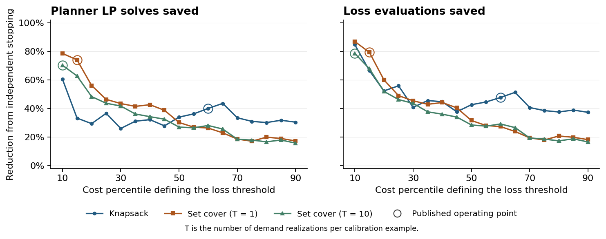
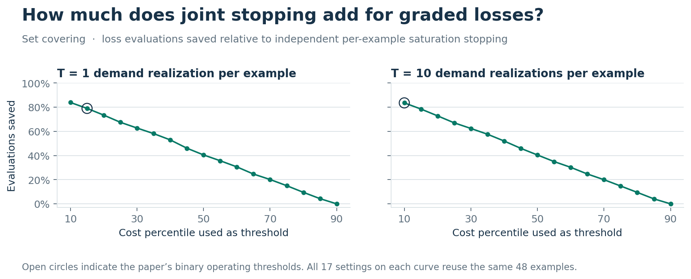
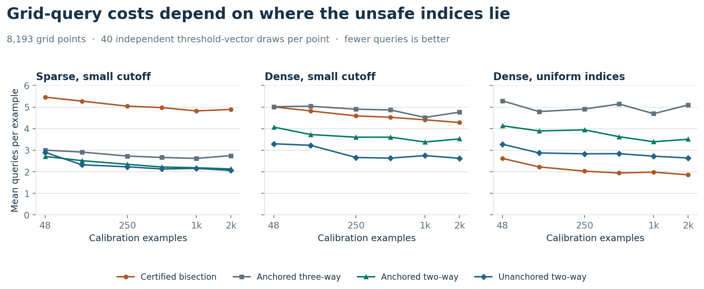
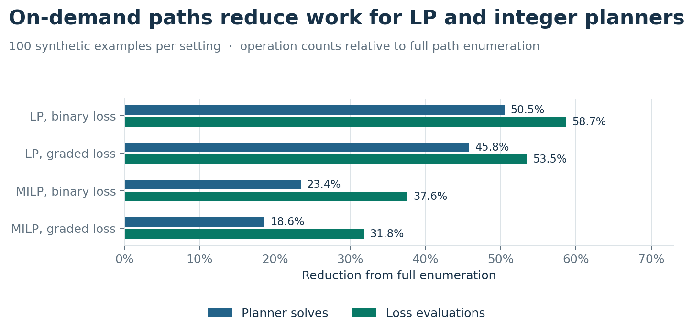
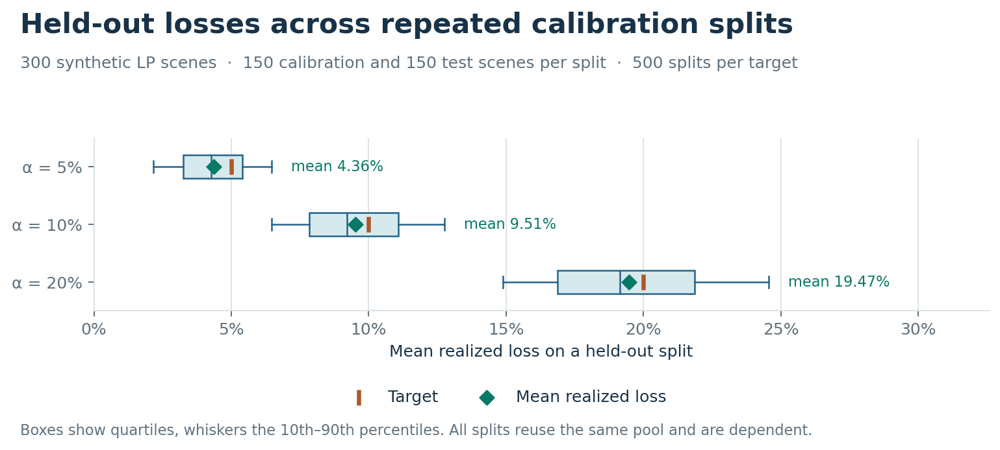

# Experiments

All commands below start at the repository root. The recorded environment used Python 3.12.14. The replay checks use the supplied public coefficients, fixed seeds and archived paths and can run offline once the dependencies are installed.

~~~
python -m pip install -r experiments/requirements.txt
python experiments/verify.py
python experiments/verify.py --full
python experiments/plot_results.py
python experiments/joint_stopping/plot.py
~~~

The short check replays all 51 binary and 34 graded comparisons, compares their counts and boundaries to the archived records, checks the archived timing runs against those counts, and tests ties and path prefixes. The full check additionally rebuilds the synthetic planners, repeats the grid scaling and held-out studies, and enumerates all binary decisions in the 22-variable MILP validation. It compares the regenerated tables with the archived tables. Wall times vary by machine. Commands write verification outputs to a temporary directory. The [results notebook](extension_experiments.ipynb) opens the figures and tables directly in Jupyter.

## Binary loss and the cost of joint stopping

One example’s path can stop at its first unsafe decision. The independent baseline uses that rule on **every** example and selects the batch boundary afterward. The joint method interleaves these same paths in descending order of the event parameter and can stop once four distinct examples are unsafe. Both use the same planner, event generator, optimization tolerances, realized losses and calibration budget (48 examples, α = 0.10).

In two-stage set covering, T is the number of independent demand realizations per calibration example. We fix the first-stage plan, solve integer recourse for each realization, and threshold the planned cost plus mean recourse cost.

| Task at published threshold | Independent → joint LP solves | Independent → joint loss evaluations | Independent → joint seconds | Time ratio | Runs per method |
| --- | ---: | ---: | ---: | ---: | ---: |
| Knapsack | 1,665 → 999 | 803 → 420 | 8.00 → 4.09 | 1.96× | 3 |
| Set covering, one demand realization | 3,702 → 961 | 1,780 → 368 | 65.06 → 13.54 | 4.80× | 3 |
| Set covering, ten demand realizations | 2,526 → 750 | 1,197 → 257 | 176.92 → 40.12 | 4.41× | 3 |

The ratios use unrounded median serial wall times for each method. Each method has three timings per task. Timings cover fresh LP solves, scoring and stopping on one CPU core, with warm-up outside the timer. At the operating point with one demand realization, full enumeration requires 23,128 LP solves and 11,588 loss evaluations. The joint sweep uses **95.8% fewer solves and 96.8% fewer evaluations relative to full enumeration**, or **74.0% fewer solves and 79.3% fewer evaluations relative to independent stopping**. The 4.80× wall-time ratio uses the independent baseline.

Across the 34 set-covering task–threshold combinations, the joint sweep uses a median of **29.1% fewer planner solves and 30.3% fewer loss evaluations** than independent stopping.

The original full-enumeration records give **estimated speedups of 44.5× and 74.6×** for one and ten demand realizations per example. These divide the sum of the measured exhaustive stages (388.96 s and 1,358.31 s) by the median end-to-end sweep time from the same experiment (8.749 s and 18.206 s). Generating all paths first and then sweeping their losses gives estimated ratios of 32.5× and 16.6×. The 4.80× and 4.41× comparisons use separate, fully timed runs of independent and joint stopping.

Changes in the loss threshold affect how far the sweep must travel. Across the 17 thresholds per task, both operation counts fall in all 51 settings and both fall by at least 25% in 40. Median reductions in solves and evaluations are 32.1% and 44.5% for knapsack, 30.1% and 31.5% for set covering with one demand realization, and 28.0% and 29.1% for set covering with ten demand realizations. Each curve reuses the same examples. Rings identify the published thresholds. [Count table](joint_stopping/thresholds.csv) · [Raw timings](joint_stopping/timings.jsonl) · [Trace generation and fresh timing instructions](joint_stopping/README.md)

## Graded recourse loss

For the same normalized realized plan-plus-repair cost c used in the binary benchmark, the graded extension uses L = min(1, max(0, c/τ − 1)). The graded sweep tracks each example’s largest loss encountered so far. For comparison, each independent scan also stops once that maximum reaches one. A full suffix-majorant calculation checks the common boundary. The supplied paths assign an interior breakpoint to the decision on its right and use inward endpoint decisions. The point-aware reference checks the deployed value and the number of charged decision losses.

| Set covering | Independent → joint losses | Reduction | Nonmonotone examples | Last-unsafe analogue (budget-crossing boundary) |
| --- | ---: | ---: | ---: | ---: |
| One demand realization | 11,171 → 2,347 | 79.0% | 47/48 | 0.132640 |
| Ten demand realizations | 10,673 → 1,755 | 83.6% | 48/48 | 0.162825 |

These are trace-replay counts at the original **binary** operating thresholds. Across all 17 thresholds, median savings are 40.5% and 40.4%, respectively. At the 90th percentile both methods evaluate all 11,588 decisions. The threshold choice uses the benchmark examples, so this comparison measures computational work. [All 34 settings](extensions/results/graded_counts.csv) · [Graded replay](extensions/graded_comparison.py) · [Point-aware reference](extensions/point_sweep.py)

## Grid search and selection

The discrete study varies calibration size over 48, 100, 250, 500, 1,000 and 2,000 and grid size over 129, 1,025 and 8,193. In the small-cutoff regimes the last unsafe index, conditional on being positive, is a discretized Beta(1.2, 25) draw. The probabilities of a positive index are 0.35 and 0.90. The third regime uses uniform positive indices with probability 0.95. There are 40 draws per cell, from seed 2026. Ordinary bisection, certified bisection, three-way anchored Quickselect and both two-way variants return the same cutoff in all 2,160 trials.

Relative to three-way anchored selection, two-way anchored selection saves a median 21.9% in queries across the 54 cell means (range 9.7–31.3%). At n = 2,000 and J = 8,193, the sparse small-cutoff regime takes 2.13 queries per example with anchored two-way selection versus 4.89 with certified bisection. In the dense uniform regime, certified bisection takes 1.85 versus 3.50 for anchored two-way selection. The column LB in the data is the theorem’s worst-case lower bound, which applies on a hard instance. [Full table](extensions/results/scaling.csv) · [Algorithms and generator](extensions/selection.py)

## Integer planners, graded losses and grid resolution

The synthetic resource-allocation study compares continuous LP planners (30 variables, five constraints) and binary MILP planners (22 variables, four constraints). The feasible set is held fixed while the objective varies affinely in the parameter. Each arm uses 100 scenes (seed 2026), α = 0.10, and either the binary resource-limit violation or its clipped excess scaled by 0.25. The limit is fixed at 0.65. The full path and the lazy interval procedure agree on the boundary to numerical tolerance in all four arms. The figure reports operation counts, which can be reproduced independently of machine speed. [Counts and boundaries](extensions/results/planner_study.csv) · [Study code](extensions/planner_study.py)

For the graded arms we also calibrate on the suffix majorant of a 129-point grid, using recorded paths to evaluate the grid. Both grid cutoffs are 0.2265625. The continuous-domain boundaries are 0.219401 (LP) and 0.222530 (MILP). Selecting an interior point just to the right gives 3.68% and 1.33% higher mean objective intercept on these same calibration scenes. This is an in-sample comparison. The table records the interior point actually evaluated.

The exhaustive check visits all 4,194,304 binary vectors per scene, filters by feasibility, and reconstructs the upper envelope over [0, 1]. Both methods recover the same 1,311 open winning pieces in total, the same decision on each piece, and matching binary and graded cutoffs to numerical tolerance. [Per-scene errors](extensions/results/exhaustive_milp_scenes.csv) · [Cutoffs](extensions/results/exhaustive_milp_cutoffs.csv) · [Enumerator](extensions/exhaustive_milp.py)

The supplemental latency probe times six fixed parameter values in 60 MILP scenes. At 0.50 and 0.85 the unconstrained sign optimum already satisfies the constraints in all 60 scenes. At 0.05 and 0.15 it does so in none. The timing variation therefore mixes solver behavior with changes in instance difficulty. [Raw times and feasibility indicators](extensions/results/milp_latency.csv)

## Held-out graded risk and exact event checks

A fixed-seed pool of 300 synthetic 25-variable LP scenes supplies 150 calibration and 150 held-out examples per split. Among the 300 loss curves, 106 are nonmonotone. Reusing the pool for 500 splits at each target gives the following averages. Each split uses a point-aware sweep on precomputed paths, checks the calibration budget at the deployed parameter, and scores the held-out examples there. The split means are dependent because the pool is reused.

| Target | Mean held-out realized loss | Mean held-out suffix majorant |
| ---: | ---: | ---: |
| 0.05 | 0.04364 | 0.04373 |
| 0.10 | 0.09511 | 0.09565 |
| 0.20 | 0.19474 | 0.19574 |

[Per-split results and deployed parameters](extensions/results/pool_splits.csv) · [Study code](extensions/split_study.py)

The interval-only lazy planner benchmark assumes adjacent tie choices and inward endpoint choices. An optimizer chosen only at a single parameter can have a different loss. The separate reference processes the actual decision at each point before the open interval to its left. Tests cover singleton losses at both endpoints and at an interior three-way tie, 729 rational graded-loss configurations, and 2,030 tied discrete rank cases.

A separate rational-arithmetic check follows 6,144 path emissions over 1,024 paths. For the paper’s generator and m ≥ 2 successful emissions, the exact number of solves is 2m + s − 1{m = h}, where h counts all open winning pieces and s counts discovered interior lines still awaiting emission. This gives 2h − 1 on full enumeration for h ≥ 2 and preserves Proposition 4.4’s upper bound. The appendix gives the exact count, including its terminal-emission term. [Checks](extensions/check_edge_cases.py)
